# Event Storming — Sistema Integrado de Atendimento e Execução de Serviços

Transcrição do quadro de Event Storming (`event-storming.jpg`).

## Legenda

| Sigla | Elemento | Cor no quadro |
|---|---|---|
| **ATR** | Ator | Amarelo |
| **CMD** | Comando | Azul |
| **EVT** | Evento de domínio | Laranja |
| **POL** | Política / regra de negócio | Roxo |
| **MDL** | Modelo de leitura (read model) | Verde |
| **EXT** | Sistema externo | Rosa |
| **Hotspot** | Dúvida / decisão em aberto | Vermelho |
| — | Agregado / entidade | Amarelo-claro (post-it grande) |

---

## 1. Criação e acompanhamento da Ordem de Serviço

### 1.1 Identificação do cliente

| Ator | Comando | Agregado | Evento | Política | Modelo de leitura |
|---|---|---|---|---|---|
| Atendente | Identifica/Registra o cliente | Cliente | Cliente identificado | — | Lista de clientes |

### 1.2 Identificação do veículo

| Ator | Comando | Agregado | Evento | Política | Modelo de leitura |
|---|---|---|---|---|---|
| Atendente | Identifica/Registra veículo | Veículo | Veículo identificado | — | Lista de veículos |

### 1.3 Criação da Ordem de Serviço

| Ator | Comando | Agregado | Evento | Política | Modelo de leitura |
|---|---|---|---|---|---|
| Atendente | Cria a ordem de serviço | Ordem de serviço | Ordem de serviço criada | Status da ordem muda para "Criada" | Lista de OS criadas |

### 1.4 Inclusão dos serviços solicitados

| Ator | Comando | Agregado | Evento | Política | Modelo de leitura |
|---|---|---|---|---|---|
| Atendente | Incluí serviços solicitados | Serviços | Serviços solicitados incluídos | Status da ordem muda para "Recebida" | Lista de serviços |

### 1.5 Diagnóstico

| Ator | Comando | Agregado | Evento | Política | Modelo de leitura |
|---|---|---|---|---|---|
| Mecânico | Inicia diagnóstico | Ordem de serviço | Diagnóstico iniciado | Status da ordem muda para "Em diagnóstico" | — |

### 1.6 Inclusão de peças e insumos

| Ator | Comando | Agregado | Evento | Política | Modelo de leitura |
|---|---|---|---|---|---|
| Mecânico | Incluí peças e insumos necessários | Peças e insumos | Peças e insumos necessários incluídos | Validar se há estoque da peça/insumo | Lista de peças e insumos |

Ao incluir peças e insumos, a política de validação de estoque dispara a baixa no estoque (ver [3.3 Baixa de estoque](#33-baixa-de-estoque)).

> **Hotspot:** O que acontece caso não haja estoque?
> **Decisão:** a disponibilidade é validada **na inclusão** da peça na OS. Sem saldo, o comando é rejeitado: não se orça peça que não existe. Isso mantém o orçamento fiel ao que a oficina consegue executar.

### 1.7 Geração do orçamento

| Ator | Comando | Agregado | Evento | Políticas | Sistema externo |
|---|---|---|---|---|---|
| — | Gera o orçamento | Orçamento | Orçamento gerado → Orçamento recebido pelo cliente | ver abaixo | Sistema de notificação |

Políticas:

- Cálculo do orçamento é gerado;
- Todo orçamento é gerado imediatamente após a inclusão das peças e insumos;
- Cada geração cria uma nova versão do orçamento;
- Status da ordem muda para "Aguardando aprovação".

### 1.8 Aprovação ou recusa do orçamento

| Ator | Comando | Evento | Política | Modelo de leitura |
|---|---|---|---|---|
| Cliente | Aprova orçamento | Orçamento aprovado | Aprovação e recusa exigem token de uso único | Lista de OS aprovadas |
| Cliente | Recusa orçamento | Orçamento recusado | Status da ordem muda para "Em diagnóstico" | Lista de orçamentos recusados |

Quando o orçamento é recusado, a OS volta para "Em diagnóstico" e o fluxo retorna ao **Mecânico** (inclusão/remoção de peças e insumos), gerando uma nova versão do orçamento.

### 1.9 Execução

| Ator | Comando | Evento | Políticas | Modelo de leitura |
|---|---|---|---|---|
| Mecânico | Inicia a execução | Execução iniciada | O orçamento deve estar aprovado · Status da ordem muda para "Em execução" | Lista de OS aprovadas |
| Mecânico | Finaliza a execução | Execução finalizada | Calculado tempo médio de execução · Status da ordem muda para "Finalizada" | Tempo médio de execução |

### 1.10 Entrega

| Ator | Comando | Evento | Política | Modelo de leitura |
|---|---|---|---|---|
| Atendente | Registra entrega do veículo | Entrega realizada | Status da ordem muda para "Entregue" | Lista de OS finalizadas |

### Fluxo resumido

```mermaid
flowchart LR
    A[Cliente identificado] --> B[Veículo identificado]
    B --> C["Ordem de serviço criada<br/>(Criada)"]
    C --> D["Serviços solicitados incluídos<br/>(Recebida)"]
    D --> E["Diagnóstico iniciado<br/>(Em diagnóstico)"]
    E --> F[Peças e insumos necessários incluídos]
    F --> G["Orçamento gerado<br/>(Aguardando aprovação)"]
    G --> H[Orçamento recebido pelo cliente]
    H --> I{Cliente}
    I -- aprova --> J[Orçamento aprovado]
    I -- recusa --> K["Orçamento recusado<br/>(Em diagnóstico)"]
    K --> F
    J --> L["Execução iniciada<br/>(Em execução)"]
    L --> M["Execução finalizada<br/>(Finalizada)"]
    M --> N["Entrega realizada<br/>(Entregue)"]
```

---

## 2. Gestão de serviços

| Ator | Comando | Evento | Modelo de leitura |
|---|---|---|---|
| Gerente | Cadastra/atualiza serviço | Serviço cadastrado/atualizado | Lista de serviços |

---

## 3. Gestão de peças e insumos

### 3.1 Cadastro de peças e insumos

| Ator | Comando | Evento |
|---|---|---|
| Gerente | Cadastra/atualiza peça ou insumo | Peça ou insumo cadastrado/atualizado |

### 3.2 Entrada de estoque

| Ator | Comando | Evento |
|---|---|---|
| Gerente | Registra entrada de mercadoria | Entrada do estoque registrada |

### 3.3 Baixa de estoque

Disparada pela inclusão de peças e insumos na OS (ver [1.6](#16-inclusão-de-peças-e-insumos)).

| Ator | Comando | Evento | Política |
|---|---|---|---|
| Sistema | Realiza baixa da peça/insumo | Baixa da peça/insumo realizada | Validar se há estoque da peça/insumo |

### 3.4 Remoção de peça/insumo da OS e estorno

| Ator | Comando | Evento | Política |
|---|---|---|---|
| Mecânico | Remove peça ou insumo da OS | Peça ou insumo removido | A recusa de um orçamento não realiza estorno, somente a remoção da peça ou insumo |
| Sistema | Realiza estorno de peça ou insumo | Estorno de peça ou insumo realizado | Estornar quantidade ao estoque |

---

## Consolidado

### Atores

- Atendente
- Mecânico
- Cliente
- Gerente
- Sistema

### Agregados / entidades

- Cliente
- Veículo
- Ordem de serviço
- Serviços
- Peças e insumos
- Orçamento

### Comandos

- Identifica/Registra o cliente
- Identifica/Registra veículo
- Cria a ordem de serviço
- Incluí serviços solicitados
- Inicia diagnóstico
- Incluí peças e insumos necessários
- Gera o orçamento
- Aprova orçamento
- Recusa orçamento
- Inicia a execução
- Finaliza a execução
- Registra entrega do veículo
- Cadastra/atualiza serviço
- Cadastra/atualiza peça ou insumo
- Registra entrada de mercadoria
- Realiza baixa da peça/insumo
- Remove peça ou insumo da OS
- Realiza estorno de peça ou insumo

### Eventos de domínio

- Cliente identificado
- Veículo identificado
- Ordem de serviço criada
- Serviços solicitados incluídos
- Diagnóstico iniciado
- Peças e insumos necessários incluídos
- Orçamento gerado
- Orçamento recebido pelo cliente
- Orçamento aprovado
- Orçamento recusado
- Execução iniciada
- Execução finalizada
- Entrega realizada
- Serviço cadastrado/atualizado
- Peça ou insumo cadastrado/atualizado
- Entrada do estoque registrada
- Baixa da peça/insumo realizada
- Peça ou insumo removido
- Estorno de peça ou insumo realizado

### Políticas / regras de negócio

- Status da ordem muda para "Criada"
- Status da ordem muda para "Recebida"
- Status da ordem muda para "Em diagnóstico" (ao iniciar diagnóstico e ao recusar orçamento)
- Status da ordem muda para "Aguardando aprovação"
- Status da ordem muda para "Em execução"
- Status da ordem muda para "Finalizada"
- Status da ordem muda para "Entregue"
- Validar se há estoque da peça/insumo
- Cálculo do orçamento é gerado
- Todo orçamento é gerado imediatamente após a inclusão das peças e insumos
- Cada geração cria uma nova versão do orçamento
- Aprovação e recusa exigem token de uso único
- O orçamento deve estar aprovado (para iniciar a execução)
- Calculado tempo médio de execução
- A recusa de um orçamento não realiza estorno, somente a remoção da peça ou insumo
- Estornar quantidade ao estoque

### Modelos de leitura

- Lista de clientes
- Lista de veículos
- Lista de OS criadas
- Lista de serviços
- Lista de peças e insumos
- Lista de orçamentos recusados
- Lista de OS aprovadas
- Tempo médio de execução
- Lista de OS finalizadas

### Sistemas externos

- Sistema de notificação

### Hotspots

- **O que acontece caso não haja estoque?** Decisão: validar a disponibilidade na inclusão da peça na OS e rejeitar o comando sem saldo.
