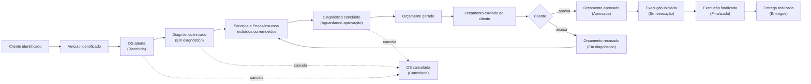

# Event Storming — Sistema Integrado de Atendimento e Execução de Serviços

Transcrição do quadro de Event Storming, versão 2.

- Quadro: [`event-storming.png`](event-storming.png) e [`event-storming.pdf`](event-storming.pdf), gerados da fonte editável [`event-storming.html`](event-storming.html).
- Diagramas: [`diagramas.pdf`](diagramas.pdf), gerado de [`diagramas.html`](diagramas.html), com agregados, bounded contexts e máquina de status da OS.
- Versão anterior do quadro, mantida para registrar a evolução: [`event-storming-v1.jpg`](event-storming-v1.jpg).
- Mudanças aplicadas sobre a versão 1: [`alteracoes-event-storming.md`](alteracoes-event-storming.md).

Os termos seguem o [`GLOSSARY.md`](../../GLOSSARY.md).

## Legenda

| Elemento | Cor no quadro |
|---|---|
| Ator | Amarelo |
| Comando | Azul |
| Evento de domínio | Laranja |
| Política / regra de negócio | Roxo |
| Modelo de leitura | Verde |
| Sistema externo | Rosa |
| Hotspot | Vermelho |
| Agregado | Amarelo-claro (post-it grande, com borda) |

## Bounded contexts

| Contexto | Tipo | Conteúdo |
|---|---|---|
| **Atendimento** | Core | Cliente, Veículo, Ordem de Serviço (com orçamento, itens e Histórico de status) |
| **Catálogo e Estoque** | Supporting | Serviço, Peça/insumo (com saldo), Entrada de mercadoria, Baixa e Estorno |
| **Identidade e Acesso** | Generic | Keycloak: usuários e papéis Atendente, Mecânico e Gerente |

Atendimento consulta preços do Catálogo e dispara Baixa e Estorno no Estoque, na mesma transação ([ADR 0003](../adr/0003-os-como-agregado-do-fluxo.md)). No código, Atendimento e Catálogo e Estoque são módulos do monólito.

---

## Fluxo 1: Criação da OS

### 1.1 Identificação do cliente

| Ator | Comando | Agregado | Evento | Políticas | Modelo de leitura |
|---|---|---|---|---|---|
| Atendente | Identifica/registra cliente; Atualiza/inativa cliente | Cliente | Cliente identificado | Validar CPF/CNPJ (numérico e alfanumérico); Exclusão é sempre lógica (Inativo) | Lista de clientes |

### 1.2 Identificação do veículo

| Ator | Comando | Agregado | Eventos | Políticas | Modelo de leitura |
|---|---|---|---|---|---|
| Atendente | Identifica/registra veículo; Transfere veículo | Veículo | Veículo identificado; Veículo transferido | Validar placa (padrão antigo e Mercosul); Exclusão é sempre lógica (Inativo) | Lista de veículos |

### 1.3 Abertura da OS

| Ator | Comando | Agregado | Evento | Políticas |
|---|---|---|---|---|
| Atendente | Abre a OS | Ordem de Serviço | OS aberta | O Cliente da OS deve ser o Proprietário atual do Veículo; Só pode existir uma OS em andamento por Veículo; Status da ordem muda para Recebida; Toda mudança de status é registrada no Histórico de status (origem, destino, momento, autor) |

### 1.4 Serviços da OS

| Atores | Comandos | Eventos | Políticas | Modelo de leitura |
|---|---|---|---|---|
| Atendente (em Recebida); Mecânico (em Em diagnóstico) | Inclui serviço na OS; Remove serviço da OS | Serviço incluído na OS; Serviço removido da OS | Itens só podem ser incluídos ou removidos em Em diagnóstico (ou Serviços pelo Atendente em Recebida); Um Serviço não se repete na mesma OS | Lista de serviços |

### 1.5 Diagnóstico

| Ator | Comando | Evento | Políticas |
|---|---|---|---|
| Mecânico | Inicia diagnóstico | Diagnóstico iniciado | Status da ordem muda para Em diagnóstico; Registrado no Histórico de status |

### 1.6 Inclusão de peças e insumos

| Ator | Comando | Evento | Políticas | Modelo de leitura |
|---|---|---|---|---|
| Mecânico | Inclui Peça/insumo na OS | Peça/insumo incluído na OS | Itens só podem ser incluídos ou removidos em Em diagnóstico; Validar saldo: sem saldo, o comando é rejeitado; Incluir Peça/insumo já presente soma à quantidade; Peça aceita apenas quantidade inteira, Insumo aceita fração; Realiza Baixa (ver 3.4) | Lista de peças e insumos da OS |

> **Hotspot:** O que acontece caso não haja estoque?
> **Decisão:** a disponibilidade é validada **na inclusão**. Sem saldo, o comando é rejeitado: não se orça peça que não existe. Ver [ADR 0002](../adr/0002-baixa-de-estoque-na-inclusao.md).

### 1.7 Remoção de peça ou insumo

| Ator | Comando | Evento | Políticas |
|---|---|---|---|
| Mecânico | Remove Peça/insumo da OS | Peça/insumo removido da OS | Remoção pode ser parcial, com Estorno proporcional; Realiza Estorno (ver 3.5); A recusa do orçamento não estorna, só a remoção estorna |

### 1.8 Conclusão do diagnóstico

| Ator | Comando | Evento | Políticas |
|---|---|---|---|
| Mecânico | Conclui diagnóstico | Diagnóstico concluído | Concluir diagnóstico exige ao menos um Serviço; Todo orçamento é gerado ao concluir o diagnóstico; Status da ordem muda para Aguardando aprovação; Registrado no Histórico de status |

---

## Fluxo 2: Acompanhamento da OS

### 2.1 Geração do orçamento

| Política que reage | Eventos | Políticas | Sistema externo |
|---|---|---|---|
| Gera o orçamento | Orçamento gerado; Orçamento enviado ao cliente | A Versão do orçamento congela os preços do catálogo; Total = Σ preço dos Serviços + Σ quantidade × preço das Peças/insumos; Cada Versão do orçamento tem um Token de aprovação de uso único, e nova versão invalida o token anterior | Sistema de notificação (simulado no MVP: registra a mensagem e o token) |

### 2.2 Aprovação do orçamento

| Ator | Comando | Evento | Políticas | Modelo de leitura |
|---|---|---|---|---|
| Cliente (com Token de aprovação) | Aprova orçamento | Orçamento aprovado | O token não expira por tempo; perde validade ao ser usado, ao gerar nova versão ou ao cancelar a OS; Status da ordem muda para Aprovada; Registrado no Histórico de status | Lista de OS aprovadas (fila de trabalho do Mecânico) |

### 2.3 Recusa do orçamento

| Ator | Comando | Evento | Políticas | Modelo de leitura |
|---|---|---|---|---|
| Cliente (com Token de aprovação) | Recusa orçamento (motivo opcional) | Orçamento recusado | Status da ordem muda para Em diagnóstico; O motivo da recusa é visível ao Mecânico no diagnóstico seguinte; Registrado no Histórico de status | Lista de orçamentos recusados |

Depois da recusa, o fluxo volta ao Mecânico (1.4 a 1.7) e a nova conclusão do diagnóstico gera outra Versão do orçamento.

### 2.4 Cancelamento da OS

| Ator | Comando | Evento | Políticas |
|---|---|---|---|
| Atendente | Cancela a OS (motivo obrigatório) | OS cancelada | Só é possível cancelar em Recebida, Em diagnóstico ou Aguardando aprovação; Status da ordem muda para Cancelada; Estornar todas as Peças/insumos da OS; Invalidar o token da Versão do orçamento pendente; Registrado no Histórico de status |

### 2.5 Início da execução

| Ator | Comando | Evento | Políticas | Modelo de leitura |
|---|---|---|---|---|
| Mecânico | Inicia a execução | Execução iniciada | A OS deve estar Aprovada; Status da ordem muda para Em execução; Registrado no Histórico de status | Lista de OS aprovadas (fila de trabalho do Mecânico) |

> **Hotspot:** Reparos adicionais durante a execução: **fora do MVP**. Não existe transição de Em execução de volta para Aguardando aprovação; ajustes de itens só acontecem no ciclo de diagnóstico, antes da aprovação.

### 2.6 Fim da execução

| Ator | Comando | Evento | Políticas | Modelo de leitura |
|---|---|---|---|---|
| Mecânico | Finaliza a execução | Execução finalizada | Registrado Tempo de execução da OS (início → finalização); Status da ordem muda para Finalizada; Registrado no Histórico de status | Tempo médio de execução |

### 2.7 Entrega

| Ator | Comando | Evento | Políticas | Modelo de leitura |
|---|---|---|---|---|
| Atendente | Registra entrega do Veículo | Entrega realizada | Entrega não depende de pagamento, e Entregue é status final; Status da ordem muda para Entregue; Registrado no Histórico de status | Lista de OS finalizadas |

### 2.8 Acompanhamento pelo cliente e pela oficina

| Atores | Modelos de leitura |
|---|---|
| Cliente (sem login) | Acompanhamento da OS (cliente): consulta pelo Número da OS (`OS-AAAA-NNNNN`) + CPF/CNPJ; mostra Status da OS e Histórico de status, sem nomes de funcionários |
| Atendente | Lista de OS: oculta Entregue e Cancelada por padrão; ordena por status (Em execução, Aprovada, Aguardando aprovação, Em diagnóstico, Recebida, Finalizada) e, dentro do status, pela mais antiga |

---

## Fluxo 3: Gestão de peças e insumos (Catálogo e Estoque)

### 3.1 Gestão de serviços

| Ator | Comando | Agregado | Evento | Política | Modelo de leitura |
|---|---|---|---|---|---|
| Gerente | Cadastra/atualiza/inativa Serviço | Serviço | Serviço cadastrado/atualizado/inativado | Exclusão é sempre lógica (Inativo) | Lista de serviços |

### 3.2 Cadastro de peças e insumos

| Ator | Comando | Agregado | Evento | Política | Modelo de leitura |
|---|---|---|---|---|---|
| Gerente | Cadastra/atualiza/inativa Peça/insumo | Peça/insumo (com saldo) | Peça/insumo cadastrado/atualizado/inativado | Exclusão é sempre lógica (Inativo) | Lista de peças e insumos |

### 3.3 Entrada de mercadoria

| Ator | Comando | Evento | Política | Modelo de leitura |
|---|---|---|---|---|
| Gerente | Registra Entrada de mercadoria | Entrada de mercadoria registrada | O saldo da Peça/insumo aumenta | Saldo da Peça/insumo |

### 3.4 Baixa

| Política que reage | Evento | Políticas |
|---|---|---|
| Realiza Baixa, disparada por Peça/insumo incluído na OS | Baixa realizada | Saldo nunca fica negativo; Baixa e OS são gravadas na mesma transação |

### 3.5 Estorno

| Política que reage | Evento | Política |
|---|---|---|
| Realiza Estorno, disparado por Peça/insumo removido da OS e por OS cancelada | Estorno realizado | Estornar quantidade ao saldo |

---

## Identidade e Acesso

Keycloak mantém usuários e papéis (Atendente, Mecânico, Gerente). O Gerente pode realizar qualquer ação administrativa. O Cliente não tem conta: consulta, aprova e recusa sem login ([ADR 0001](../adr/0001-keycloak-para-autenticacao-administrativa.md)).

---

## Fluxo resumido

---

## Consolidado

### Atores

Atendente, Mecânico, Cliente, Gerente.

### Agregados

Cliente, Veículo, Ordem de Serviço, Serviço, Peça/insumo. Orçamento (Versões do orçamento), Serviços da OS, itens de Peça/insumo e Histórico de status são entidades internas da Ordem de Serviço ([ADR 0003](../adr/0003-os-como-agregado-do-fluxo.md)).

### Comandos

- Identifica/registra cliente
- Atualiza/inativa cliente
- Identifica/registra veículo
- Transfere veículo
- Abre a OS
- Inclui serviço na OS
- Remove serviço da OS
- Inicia diagnóstico
- Inclui Peça/insumo na OS
- Remove Peça/insumo da OS
- Conclui diagnóstico
- Aprova orçamento
- Recusa orçamento
- Cancela a OS
- Inicia a execução
- Finaliza a execução
- Registra entrega do Veículo
- Cadastra/atualiza/inativa Serviço
- Cadastra/atualiza/inativa Peça/insumo
- Registra Entrada de mercadoria

### Eventos de domínio

- Cliente identificado
- Veículo identificado
- Veículo transferido
- OS aberta
- Serviço incluído na OS
- Serviço removido da OS
- Diagnóstico iniciado
- Peça/insumo incluído na OS
- Peça/insumo removido da OS
- Diagnóstico concluído
- Orçamento gerado
- Orçamento enviado ao cliente
- Orçamento aprovado
- Orçamento recusado
- OS cancelada
- Execução iniciada
- Execução finalizada
- Entrega realizada
- Serviço cadastrado/atualizado/inativado
- Peça/insumo cadastrado/atualizado/inativado
- Entrada de mercadoria registrada
- Baixa realizada
- Estorno realizado

### Políticas

- Toda mudança de status é registrada no Histórico de status (origem, destino, momento, autor)
- Status da ordem muda para Recebida, Em diagnóstico, Aguardando aprovação, Aprovada, Em execução, Finalizada, Entregue ou Cancelada
- O Cliente da OS deve ser o Proprietário atual do Veículo
- Só pode existir uma OS em andamento por Veículo
- Validar CPF/CNPJ (numérico e alfanumérico) e placa (padrão antigo e Mercosul)
- Exclusão é sempre lógica (Inativo)
- Itens só podem ser incluídos ou removidos em Em diagnóstico (ou Serviços pelo Atendente em Recebida)
- Um Serviço não se repete na mesma OS
- Validar saldo: sem saldo, o comando é rejeitado
- Incluir Peça/insumo já presente soma à quantidade
- Peça aceita apenas quantidade inteira, Insumo aceita fração
- Remoção pode ser parcial, com Estorno proporcional
- Realiza Baixa e Realiza Estorno
- A recusa do orçamento não estorna
- Concluir diagnóstico exige ao menos um Serviço
- Todo orçamento é gerado ao concluir o diagnóstico
- A Versão do orçamento congela os preços do catálogo
- Total = Σ preço dos Serviços + Σ quantidade × preço das Peças/insumos
- Cada Versão do orçamento tem um Token de aprovação de uso único; o token não expira por tempo e perde validade ao ser usado, ao gerar nova versão ou ao cancelar a OS
- O motivo da recusa é visível ao Mecânico no diagnóstico seguinte
- Só é possível cancelar em Recebida, Em diagnóstico ou Aguardando aprovação
- Estornar todas as Peças/insumos da OS e invalidar o token pendente ao cancelar
- A OS deve estar Aprovada para iniciar a execução
- Registrado Tempo de execução da OS (início → finalização)
- Entrega não depende de pagamento, e Entregue é status final
- Saldo nunca fica negativo

### Modelos de leitura

- Lista de clientes
- Lista de veículos
- Lista de serviços
- Lista de peças e insumos
- Lista de OS (oculta Entregue e Cancelada por padrão, ordenada por status e antiguidade)
- Acompanhamento da OS (cliente)
- Lista de OS aprovadas (fila de trabalho do Mecânico)
- Lista de orçamentos recusados
- Lista de OS finalizadas
- Tempo médio de execução
- Saldo da Peça/insumo

### Sistemas externos

- Sistema de notificação (simulado no MVP)
- Keycloak

### Hotspots

- **O que acontece caso não haja estoque?** Decisão: validar a disponibilidade na inclusão e rejeitar o comando sem saldo.
- **Reparos adicionais durante a execução.** Fora do MVP.

### Decisões a apresentar

- Baixa de estoque na inclusão ([ADR 0002](../adr/0002-baixa-de-estoque-na-inclusao.md)).
- OS como agregado do fluxo, gravada na mesma transação que o saldo ([ADR 0003](../adr/0003-os-como-agregado-do-fluxo.md)).
- Status extras Aprovada e Cancelada: o enunciado lista os seis status obrigatórios mas não proíbe outros. Aprovada separa a aprovação do Cliente do início real da execução; Cancelada encerra OS abandonadas.
